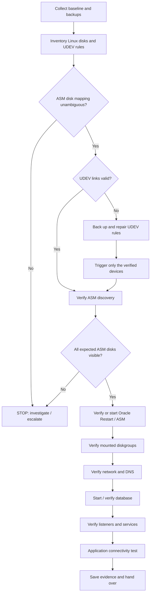

# Oracle Standalone Post-Migration Recovery — ASM + UDEV

**Category:** Oracle / Attività vita reale  
**Type:** Real-world DBA operational runbook

**ASM disks · UDEV persistent links · Oracle Restart · Database · Listeners**

A practical runbook for recovering a **single-server Oracle database using ASM disks exposed through UDEV rules** after a VM or data-center migration (for example, Zerto, SRM, or a cold move).

The most common failure covered here is simple: **the disks are visible to Linux, but ASM cannot discover them because their storage identifiers changed and the existing UDEV rules no longer match.**

> [!IMPORTANT]
> This is an **operational runbook**, not a script to execute end to end. Inspect the environment, replace example values, and verify each checkpoint before proceeding. Commands that change the system are explicitly marked.
>
> **Scope:** Oracle **standalone / Oracle Restart** with UDEV-managed ASM disks. A RAC cluster, Oracle ASM Filter Driver (AFD), ASMLib, or a different storage layout may require a different procedure.

**During a maintenance window?** Use the [recovery workflow](#recovery-workflow) and [quick command reference](#quick-command-reference) to orient yourself, then execute the relevant detailed phases and complete the [final checklist](#final-checklist). **Everything needed for this procedure is in this document.**

## Contents

1. [Recovery workflow](#recovery-workflow)
2. [Before you start](#before-you-start)
3. [Phase 0 — Collect a baseline](#phase-0--collect-a-baseline)
4. [Phase 1 — Inspect UDEV and Linux disks](#phase-1--inspect-udev-and-linux-disks)
5. [Phase 2 — Identify the correct ASM disk mapping](#phase-2--identify-the-correct-asm-disk-mapping)
6. [Phase 3 — Repair UDEV rules](#phase-3--repair-udev-rules)
7. [Phase 4 — Start and verify Oracle Restart / ASM](#phase-4--start-and-verify-oracle-restart--asm)
8. [Phase 5 — Check network and name resolution](#phase-5--check-network-and-name-resolution)
9. [Phase 6 — Start and verify the database](#phase-6--start-and-verify-the-database)
10. [Phase 7 — Verify listeners and registered services](#phase-7--verify-listeners-and-registered-services)
11. [Phase 8 — Test application connectivity](#phase-8--test-application-connectivity)
12. [Phase 9 — Save evidence and hand over](#phase-9--save-evidence-and-hand-over)
13. [Troubleshooting](#troubleshooting)
14. [Rollback and recovery boundaries](#rollback-and-recovery-boundaries)
15. [Final checklist](#final-checklist)

---

## Recovery workflow



**Critical order:** confirm the disk identity → repair UDEV **only if necessary** → confirm ASM discovery → bring Oracle services online. Do not use disk names such as `/dev/sdb` or disk size alone as proof of identity.

### Quick checkpoints

| Step | Success condition | If it fails |
| --- | --- | --- |
| Linux storage | All expected devices are visible; OS disks identified | Stop; involve the virtualization/storage team |
| UDEV | Every expected `/dev/asm/...` link resolves to the **correct** device with correct permissions | Do not start ASM |
| ASM | Expected disks discovered and diskgroups mounted | Do not start the database |
| Oracle Restart | Required resources show the intended state | Inspect resource state and logs |
| Database | Correct `DB_UNIQUE_NAME`, role, and intended open mode | Do not run application tests |
| Listener | Correct endpoint and expected database services | Check config and registration |
| Application | TNS/SQL and approved functional test succeed | Keep the ticket open |

---

## Before you start

### Required access and information

- Approved maintenance/change window and confirmation that migration or storage cutover has completed.
- `root` access for Linux, device inspection, UDEV, and Oracle Restart control.
- Access to the **Grid Infrastructure owner** (often `grid`) and the **database OS owner** (often `oracle`); in some environments each DB home has a different owner.
- Previous ASM disk inventory or UDEV configuration and an authoritative way to validate disk-to-ASM mapping.
- Correct Grid home, database home, database unique name, listener names/ports, and expected application endpoints.
- Confirmation of whether Oracle Restart is installed, whether resources are auto-started, and whether the database is a **primary or standby**.
- Explicit confirmation that the **source database is stopped/fenced or otherwise cannot conflict with the migrated copy** before bringing up a target database. A cloned target must not create a second active primary.

### What to collect before starting

Collect these values **before issuing any start or change command**. Use the real installation and approved migration inventory, never the examples below.

| Value / variable | How to find or confirm it |
| --- | --- |
| `GRID_HOME` | `/etc/oracle/olr.loc` (`crs_home`), Oracle inventory, or an existing `ohasd` process cross-check |
| `DB_HOME` | `/etc/oratab`, `DB_HOME/bin/srvctl config database`, and home ownership |
| `DB_UNIQUE_NAME` | `DB_HOME/bin/srvctl config database`; verify the configured database resource; **not necessarily `ORACLE_SID`** |
| `DB_SID` | `/etc/oratab`, running PMON processes, registered resource configuration, or existing DBA inventory |
| OS owner of each home | `ls -ld "$GRID_HOME" "$DB_HOME"`, `id <os-user>`, and the Oracle inventory |
| ASM device path and UDEV rules | `lsblk`, `multipath -ll`, `/etc/udev/rules.d/`, the historical disk mapping and `kfed` header evidence |
| Listener name, port, and managing home | `srvctl config listener`, the **effective** `listener.ora`, `ps -ef`, `ss -lntp`; check `TNS_ADMIN` |
| Hostnames and old/new IPs | Approved migration/network plan, DNS, `/etc/hosts`, and the application connection descriptors |
| Oracle database role and startup policy | DBA/change plan plus `srvctl` and SQL checks; primary and standby expectations differ |
| Source/target safety and test owners | Change ticket: source fencing, maintenance approval, and application team sign-off |

**Stop if any value affecting disk identity, Oracle resource selection, or source/target safety is uncertain.**

### Example environment variables

Set these in the appropriate shell **after discovering the real values**. They are examples, not values to copy unchanged.

```bash
# Example only — edit before use.
export GRID_HOME="/u01/app/grid"
export DB_HOME="/u01/app/oracle/product/19.0.0/dbhome_1"
export DB_UNIQUE_NAME="DBPROD"                 # Not necessarily ORACLE_SID
export DB_SID="DBPROD"
export DB_OS_USER="oracle"
export UDEV_FILE="/etc/udev/rules.d/96-asm.rules"
export DB_HOST="db01.example.com"
export APP_HOST_1="app01.example.com"
export APP_HOST_2="app02.example.com"
export NEW_GATEWAY="10.0.20.1"
```

> [!CAUTION]
> **Never** run `mkfs`, `fdisk`, `parted`, `wipefs`, `dd`, `pvcreate`, `kfed merge`, or ASM `CREATE DISKGROUP` as part of this recovery. This runbook is about **discovering existing disks**, not initializing them.
>
> If ASM/Oracle is already running or other databases share the devices, **do not apply UDEV changes or trigger events without an impact assessment and approved plan**.

### Which account and Oracle home to use

| Operation | Typical account | Oracle home / command |
| --- | --- | --- |
| Linux inventory, UDEV, device events | `root` | OS commands |
| Oracle Restart/HAS control | `root` or authorized Grid owner | `GRID_HOME/bin/crsctl` |
| ASM and diskgroup management | Grid owner / OSASM-authorized account | `GRID_HOME/bin/srvctl`, `GRID_HOME/bin/asmcmd` |
| Database status and startup | DB home owner / OSDBA-authorized account | **`DB_HOME/bin/srvctl`**, `DB_HOME/bin/sqlplus` |
| Listener management | Listener's configured home owner | `srvctl` or `lsnrctl` from the **matching home** |

> [!NOTE]
> The account and executable home are not interchangeable. In Oracle Restart, database operations should normally use **SRVCTL from the database home**, while ASM operations use Grid-home tools. Confirm rules for the installed release and local privileges.

### Important concepts

- **`/dev/sdX` is not persistent.** Kernel discovery order can change after cutover; some environments use `/dev/nvme*` or multipath `/dev/mapper/*` instead.
- **ASM metadata identifies ASM membership.** `kfed read` is a read-only inspection command; it helps identify the disk group and ASM disk. Confirm the result against the historical mapping and storage inventory.
- **Do not assume `asm01 = dsknum 0`.** That numbering may be a local convention, not a universal rule. Recover the actual link-to-disk relationship from the existing configuration and verified evidence.
- **A Grid listener may serve databases.** Whether the database uses a Grid-managed listener or a listener in its own DB home depends on the configuration. Discover it; do not assume that port `1521` is ASM-only.
- **Expected database open mode depends on the role.** A primary may be `READ WRITE`; a standby may correctly be `MOUNTED` or `READ ONLY`.

---

## Phase 0 — Collect a baseline

**Goal:** establish what is running and preserve evidence before making changes.

**Run as:** `root`, unless otherwise noted. **Changes:** evidence files only.

### 0.1 Host, time, and network (read-only)

```bash
hostname -f
id
date
timedatectl
chronyc tracking 2>/dev/null || true  # If chrony is installed.
cat /etc/os-release
uname -r
uptime

ip -br addr
ip route show
ip rule show
```

Compare the assigned IP, routes, and gateway with the approved migration plan. If the host is incorrectly re-IP'd, coordinate with the network team rather than improvising changes.

Check that the clock and NTP/chrony synchronization are healthy, not just the displayed timezone. After a data-center migration, time skew can affect Kerberos or other time-sensitive authentication and make logs difficult to correlate. `chronyc` may not be installed: use the site's configured time-sync service instead.

### 0.2 Oracle processes and inventory (read-only)

```bash
ps -ef | grep -E '[a]sm_pmon|[p]mon_|[o]hasd|[t]nslsnr'
cat /etc/oratab 2>/dev/null
cat /etc/oracle/olr.loc 2>/dev/null
getent passwd | grep -E '(^grid:|^oracle:|^ora[^:]*:)'
ls -ld /u01/app/* 2>/dev/null
```

- `/etc/oratab`: hints at database SIDs and Oracle homes; verify against the actual installation.
- `/etc/oracle/olr.loc`: when present, helps locate the local Grid Infrastructure home.
- `ps`: establishes whether ASM, a database, or a listener is **already running**.

### 0.3 Save a configuration backup (writes evidence only)

```bash
export EVID="/root/oracle_migration_$(date +%Y%m%d_%H%M%S)"
mkdir -p "$EVID"

cp -a /etc/udev/rules.d "$EVID/udev-rules.before"
[ ! -f /etc/hosts ] || cp -a /etc/hosts "$EVID/hosts.before"
[ ! -f /etc/resolv.conf ] || cp -a /etc/resolv.conf "$EVID/resolv.conf.before"
[ ! -f /etc/oratab ] || cp -a /etc/oratab "$EVID/oratab.before"
[ ! -f /etc/oracle/olr.loc ] || cp -a /etc/oracle/olr.loc "$EVID/olr.loc.before"

printf 'Evidence directory: %s\n' "$EVID"
```

**Checkpoint:** know the current processes, identify the Grid/DB homes, and confirm that backups exist before modifying UDEV.

---

## Phase 1 — Inspect UDEV and Linux disks

**Goal:** establish whether the existing persistent disk links are missing, broken, or pointing to the wrong device.

**Run as:** `root`. **Changes:** none.

### 1.1 Locate the actual ASM UDEV rules

```bash
ls -lah /etc/udev/rules.d/
grep -RInE 'asm|SYMLINK|ID_SERIAL|ID_WWN|scsi_id' /etc/udev/rules.d/ 2>/dev/null
```

Example rule:

```udev
ACTION=="add|change", KERNEL=="sd*[0-9]", ENV{ID_SERIAL_SHORT}=="EXAMPLE_SERIAL", SYMLINK+="asm/asm01", OWNER="oracle", GROUP="dba", MODE="0660"
```

Find out exactly **which property the rule matches** (`ID_SERIAL_SHORT`, `ID_WWN`, or another property). Set `UDEV_FILE` to the **real** file path; do not create a new rules file unless the existing configuration is understood.

### 1.2 Inspect existing ASM links

```bash
ls -la /dev/asm/ 2>/dev/null
ls -la /dev/asm* 2>/dev/null
ls -la /dev/oracleasm/ 2>/dev/null

if [ -d /dev/asm ]; then
  for link in /dev/asm/*; do
    [ -L "$link" ] || continue
    if [ -e "$link" ]; then
      printf 'OK: %s -> %s\n' "$link" "$(readlink -f "$link")"
    else
      printf 'BROKEN: %s\n' "$link"
    fi
  done
fi
```

**Interpretation:** missing links can be caused by mismatched UDEV properties, but may also indicate a different device-management method, a missing device, or rules that did not execute. Investigate before concluding.

### 1.3 Inventory storage devices

```bash
lsblk -p -o NAME,TYPE,SIZE,FSTYPE,MOUNTPOINTS,MODEL,SERIAL,WWN
blkid 2>/dev/null
ls -lah /dev/disk/by-id/ 2>/dev/null
ls -lah /dev/disk/by-path/ 2>/dev/null
multipath -ll 2>/dev/null
```

Identify **system/root, boot, swap, LVM, mounted and multipath devices** first; exclude them from the ASM candidate list unless architecture documentation says otherwise. Do not treat every similarly sized `/dev/sd*1` partition as an ASM disk.

### 1.4 Inspect candidate UDEV properties

Use a **small, manually verified list** of devices from the inventory rather than scanning and modifying all block devices.

```bash
# EXAMPLES ONLY — choose the actual ASM candidate paths.
CANDIDATES=(/dev/sdb1 /dev/sdc1)

for device in "${CANDIDATES[@]}"; do
  [ -b "$device" ] || { echo "MISSING: $device"; continue; }
  echo "===== $device ====="
  udevadm info --query=property --name="$device" \
    | grep -E '^(DEVNAME|ID_SERIAL|ID_SERIAL_SHORT|ID_WWN|DM_UUID|DM_NAME)='
done
```

For multipath, identify the **correct mapped device** and follow your site's multipath policy; do not confuse individual paths with independent ASM disks.

**Checkpoint:** distinguish an incorrect UDEV match from missing/incorrectly presented storage. If expected devices are absent, **stop and escalate to storage/virtualization**.

---

## Phase 2 — Identify the correct ASM disk mapping

**Goal:** make a defensible mapping of **existing ASM disk → Linux device → current persistent identifier → expected UDEV link**.

**Run as:** `root` for the examples; a suitable Oracle/Grid account can also be used when it has read access. **Changes:** none.

### 2.1 Locate `kfed`

```bash
find /u01 -type f -name kfed 2>/dev/null
# Usually: $GRID_HOME/bin/kfed
```

### 2.2 Read ASM metadata from a **known candidate**

```bash
export ORACLE_HOME="$GRID_HOME"
"$GRID_HOME/bin/kfed" read /dev/sdb1 | head -80
```

Look for fields such as:

| `kfed` field | Meaning |
| --- | --- |
| `kfdhdb.grpname` | ASM disk group name |
| `kfdhdb.dskname` | ASM disk name within the group |
| `kfdhdb.dsknum` | ASM disk number (for cross-checking) |
| `kfdhdb.hdrsts` | Disk header status; existing members normally show `KFDHDR_MEMBER` |
| `kfdhdb.driver.provstr` | Provisioning information **if populated**; it is not a universal identification test |

`kfed read` **does not repair or write a disk**. Output can still be incomplete or unexpected depending on header placement, device type, and disk state; do not force a mapping from incomplete data.

### 2.3 Build the candidate inventory

Reuse the manually confirmed `CANDIDATES` from Phase 1 (or define them in this shell).

```bash
# EXAMPLES ONLY — explicitly enumerate the discovered ASM devices.
CANDIDATES=(/dev/sdb1 /dev/sdc1)

for device in "${CANDIDATES[@]}"; do
  [ -b "$device" ] || { echo "MISSING: $device"; continue; }
  if ! header=$("$GRID_HOME/bin/kfed" read "$device" 2>/dev/null); then
    echo "KFED FAILED: $device — rerun the same read without 2>/dev/null to inspect errors" >&2
    continue
  fi
  if [ -z "$header" ]; then
    echo "EMPTY KFED OUTPUT: $device — investigate; do not infer a mapping" >&2
    continue
  fi
  disk_name=$(printf '%s\n' "$header" | awk '/kfdhdb.dskname:/ {print $2; exit}')
  dg_name=$(printf '%s\n' "$header" | awk '/kfdhdb.grpname:/ {print $2; exit}')
  disk_num=$(printf '%s\n' "$header" | awk '/kfdhdb.dsknum:/ {print $2; exit}')
  hdr_status=$(printf '%s\n' "$header" | grep -m1 'kfdhdb.hdrsts:' || true)
  serial=$(udevadm info --query=property --name="$device" 2>/dev/null \
    | awk -F= '/^ID_SERIAL_SHORT=/ {print $2; exit}')
  printf '%-22s GROUP=%-14s DISK=%-22s NUM=%-5s SERIAL=%s\n' \
    "$device" "${dg_name:-UNKNOWN}" "${disk_name:-UNKNOWN}" "${disk_num:-?}" "${serial:-N/A}"
  printf '  %s\n' "${hdr_status:-HEADER STATUS NOT FOUND}"
done
```

Optional discovery tool (syntax and supported options vary by release):

```bash
# Illustrative only: run the kfod binary from the INSTALLED Grid release.
"$GRID_HOME/bin/kfod" asm_diskstring='/dev/asm/*' disks=all verbose=true
```

**`kfod` guardrails:** confirm that the binary belongs to the installed **Grid release**, check the syntax supported by that binary, and use an **approved/validated ASM discovery path**. If `/dev/asm/*` does not exist because UDEV is broken, the example will not discover those disks. Do **not** try arbitrary wildcard paths that could include OS volumes or duplicate multipath paths. For `kfed`, a suppressed error is never proof that the device lacks an ASM header; rerun the failed read **without** `2>/dev/null` and inspect the cause.

### 2.4 Record the mapping before editing anything

Fill in this table from **`kfed` + UDEV properties + historical rules/CMDB or storage records**:

| Expected link | ASM disk name | Disk group | Current device | New ID_SERIAL_SHORT / WWN | Verified? |
| --- | --- | --- | --- | --- | --- |
| `/dev/asm/asm01` | `DGSTAR_0000` | `DGSTAR` | `/dev/sdb1` | `<actual-id-1>` | ☐ |
| `/dev/asm/asm02` | `DGSTAR_0001` | `DGSTAR` | `/dev/sdc1` | `<actual-id-2>` | ☐ |

> [!WARNING]
> The above mapping is **illustrative**. Do not infer link order from `dsknum` without independent confirmation. A wrong symlink mapping can expose the wrong ASM member to Oracle.

**Stop immediately if:**

- There are missing disks or duplicate/ambiguous device paths.
- Expected ASM headers or disk group identity cannot be verified.
- Current device identifiers are not unique or do not match the rule's chosen property.
- The historical mapping is unavailable and cannot be confirmed by another reliable source.

---

## Phase 3 — Repair UDEV rules

**Goal:** update only the identifiers that changed, while preserving the original link names and permissions.

**Run as:** `root`. **Changes:** UDEV rules and device events. **Perform only in an approved maintenance state.**

### 3.1 Back up the exact original file

```bash
[ -n "${EVID:-}" ] || { echo 'EVID not set; stop'; exit 1; }
[ -f "${UDEV_FILE:-}" ] || { echo 'UDEV_FILE not valid; stop'; exit 1; }

RULE_BASENAME=$(basename "$UDEV_FILE")
ORIGINAL_RULES="$EVID/$RULE_BASENAME.before"
NEW_RULES="$EVID/$RULE_BASENAME.new"

cp -a "$UDEV_FILE" "$ORIGINAL_RULES"
cp -a "$UDEV_FILE" "$NEW_RULES"
sha256sum "$ORIGINAL_RULES" "$NEW_RULES"
```

### 3.2 Edit the **staged copy**, never the only original

```bash
vi "$NEW_RULES"
```

Typical rule:

```udev
ACTION=="add|change", KERNEL=="sd*[0-9]", ENV{ID_SERIAL_SHORT}=="NEW_VERIFIED_SERIAL", SYMLINK+="asm/asm01", OWNER="oracle", GROUP="dba", MODE="0660"
```

**Edit only** the identifier match (`ENV{ID_SERIAL_SHORT}` or the verified equivalent, such as `ENV{ID_WWN}`). Preserve the intended symlink, owner, group, mode, and other options. If the storage naming model changed (for example, SCSI partitions to multipath or NVMe), stop: replacing serials alone may not be sufficient.

### 3.3 Review the diff before applying

```bash
diff -u "$ORIGINAL_RULES" "$NEW_RULES" || true
wc -l "$ORIGINAL_RULES" "$NEW_RULES"
```

**Expected:** only the intended identifier values differ. The same disk links and permissions remain. Have a second person review the mapping for production changes, when possible.

### 3.4 Apply the verified file **[CHANGE]**

```bash
# Only after the diff and device mapping have been approved.
cp -- "$NEW_RULES" "$UDEV_FILE"
udevadm control --reload-rules
```

### 3.5 Re-trigger **only verified ASM devices** **[CHANGE]**

```bash
# EXAMPLES ONLY — update to the same confirmed devices used for mapping.
CANDIDATES=(/dev/sdb1 /dev/sdc1)

for device in "${CANDIDATES[@]}"; do
  [ -b "$device" ] || { echo "MISSING: $device"; continue; }
  udevadm trigger --action=change --name-match="$device"
done
udevadm settle --timeout=90
```

> [!CAUTION]
> Avoid an indiscriminate `udevadm trigger --subsystem-match=block` on a live host: it affects unrelated block devices. Even targeted events must be assessed if the disks are in active use. Changing UDEV rules alone does **not** require restarting the server.

### 3.6 Verify **target and permissions**, not just link presence

```bash
ls -la /dev/asm/

for link in /dev/asm/*; do
  [ -L "$link" ] || continue
  if [ ! -e "$link" ]; then
    echo "BROKEN: $link"
    continue
  fi
  echo "OK: $link -> $(readlink -f "$link")"
  stat -Lc '%n %U:%G %a' "$link"
done
```

For **every** expected link, compare the resolved device with the Phase 2 mapping. Owner/group/mode must match the Oracle installation's design (for example, `oracle:dba` and `0660` in the original environment), **not a fixed universal value**.

**Checkpoint:** all required links point to the verified ASM disks; no link is missing/broken; permissions allow the intended Grid/ASM owner to read them. **Do not continue if this fails.**

---

## Phase 4 — Start and verify Oracle Restart / ASM

**Goal:** bring the required Grid and ASM resources to their expected state.

**Run as:** `root` or the authorized Grid owner for `crsctl`; the Grid/OSASM account for `srvctl` and ASM tools. **Changes:** service starts only when explicitly needed.

### 4.1 Check local high availability services

```bash
"$GRID_HOME/bin/crsctl" check has
"$GRID_HOME/bin/crsctl" stat res -t
```

If Oracle Restart (HAS) is down **and the storage, configuration, and startup impact have been reviewed**:

```bash
# [CHANGE] Starting HAS can automatically start other configured resources.
"$GRID_HOME/bin/crsctl" start has
"$GRID_HOME/bin/crsctl" stat res -t
```

### 4.2 Check ASM and disk groups

```bash
# Run from a shell with the correct Grid home, OS permissions and ASM SID.
export ORACLE_HOME="$GRID_HOME"
export ORACLE_SID="+ASM"  # Confirm actual ASM SID on this host.
export PATH="$ORACLE_HOME/bin:$PATH"

asmcmd lsdg
asmcmd lsdsk -p
```

Compare the result with the **expected** diskgroup and disk count. The exact resource names may differ by Oracle version/configuration; check `ora.asm`, relevant `ora.<DG>.dg` resources, and any dependencies.

If ASM is offline after UDEV has been verified:

```bash
# [CHANGE] Use only if the resource is configured and should be started.
"$GRID_HOME/bin/srvctl" start asm
"$GRID_HOME/bin/crsctl" stat res -t
```

If ASM fails, inspect the relevant ASM alert log using the site's ADR location (for example, locate it with `adrci`); avoid guessing a fixed trace path.

**Checkpoint:** all required ASM disk groups are **mounted** and expected member disks are visible. If not, **do not start the database**.

---

## Phase 5 — Check network and name resolution

**Goal:** confirm that post-migration IP configuration, Oracle Net configuration, and application endpoints agree.

**Run as:** `root` for the read-only OS checks; use the appropriate Oracle owner to verify effective network configuration. **Changes:** none by default.

### 5.1 IP, routes, IPv4 name resolution and time sync

```bash
hostname -f
ip -br addr
ip route show
ip rule show

# Find the resolver order; IPv6-only answers can obscure the desired IPv4.
grep -E '^hosts:' /etc/nsswitch.conf
getent ahostsv4 "$DB_HOST"
getent ahostsv4 "$APP_HOST_1"
getent ahostsv4 "$APP_HOST_2"

# Secondary, dual-stack view (may include IPv6/link-local records).
getent hosts "$DB_HOST"
cat /etc/hosts
cat /etc/resolv.conf

# Time synchronization matters for authentication and log correlation.
timedatectl
chronyc tracking 2>/dev/null || true

ping -c 3 "$NEW_GATEWAY"
ping -c 3 "$APP_HOST_1"
ping -c 3 "$APP_HOST_2"
```

Prefer `getent ahostsv4` when validating the **expected IPv4** after re-IP. `getent hosts` may return IPv6 (including a link-local `fe80::...`) depending on NSS configuration and the resolved records; investigate why rather than assuming the IPv4 mapping is valid. Verify the `hosts:` order in `/etc/nsswitch.conf` (for example, `files`, DNS and `myhostname`). On systems with `systemd-resolved`, account for the locally configured resolver behavior.

### 5.2 Find old IP addresses in Oracle Net configuration

```bash
# READ-ONLY: the regex inventories IPv4-looking literals. Review every match.
grep -RInE '([0-9]{1,3}\.){3}[0-9]{1,3}' "$DB_HOME/network/admin" 2>/dev/null || true
grep -RInE '([0-9]{1,3}\.){3}[0-9]{1,3}' "$GRID_HOME/network/admin" 2>/dev/null || true

# If an old address is known, search for that exact IP too (set it first).
# grep -RInF -- "$OLD_DB_IP" "$DB_HOME/network/admin" "$GRID_HOME/network/admin"

# The effective directory may be overridden by TNS_ADMIN.
printf 'TNS_ADMIN=%s\n' "${TNS_ADMIN:-<unset in this shell>}"
```

Inspect `listener.ora`, `tnsnames.ora`, and `sqlnet.ora` in the **effective** network directory of each relevant process, not just the default homes. A matching address might be valid (a remote endpoint, old comment, or intentionally retained route): **do not perform global search-and-replace**. Coordinate any listener/service descriptor change with its owner.

### 5.3 Check incoming client restrictions in `sqlnet.ora`

```bash
# READ-ONLY: check DB home, Grid home, and any active TNS_ADMIN path.
grep -RIniE 'TCP\.(VALIDNODE_CHECKING|INVITED_NODES|EXCLUDED_NODES)' \
  "$DB_HOME/network/admin" "$GRID_HOME/network/admin" 2>/dev/null || true

# If TNS_ADMIN is defined and points to a trusted local directory:
# grep -RIniE 'TCP\.(VALIDNODE_CHECKING|INVITED_NODES|EXCLUDED_NODES)' "$TNS_ADMIN"
```

When `TCP.VALIDNODE_CHECKING=YES`, `TCP.INVITED_NODES` / `TCP.EXCLUDED_NODES` can allow or reject client connections. Verify that the **new application server IPs/subnets** and any required local/listener addresses satisfy the approved access policy. These parameters must be reviewed in the `sqlnet.ora` used by the **actual listener home/process**; editing an inactive DB-home file may have no effect. Do not disable node checking to make a test pass. Oracle documents the dependence on `TCP.VALIDNODE_CHECKING` in its [19c Net Services Reference](https://docs.oracle.com/en/database/oracle/oracle-database/19/netrf/parameters-for-the-sqlnet.ora.html).

Confirm:

- Assigned address, subnet, gateway, routes, and synchronized time match the migration design.
- DB and application hostnames resolve to the **correct current IPv4 addresses** where IPv4 is expected.
- No unreviewed, stale IP literals are active in Oracle Net configuration.
- Approved `sqlnet.ora` restrictions permit the new application endpoints.
- Firewall rules allow required **TCP listener ports**; successful ping alone does not prove this.

Only modify `/etc/hosts`, `nsswitch.conf`, DNS, routes, Oracle Net files or listener endpoints after validating the change with the responsible team. Save a before/after diff. A network finding is not authorization to alter host resolution or security policy.

**Checkpoint:** there is no unresolved addressing, time synchronization, or listener access-policy issue that would invalidate registration or application tests.

---

## Phase 6 — Start and verify the database

**Goal:** bring the database to the state appropriate for its role.

**Run as:** the database-home owner or an OSDBA-authorized account for database `srvctl` and local SQL checks. Execute database `srvctl` from the **database home**. Use `root` only for separate OS-level checks.

### 6.1 Discover registered resources

```bash
"$GRID_HOME/bin/crsctl" stat res -t
"$DB_HOME/bin/srvctl" config database
"$DB_HOME/bin/srvctl" config database -db "$DB_UNIQUE_NAME"
"$DB_HOME/bin/srvctl" status database -db "$DB_UNIQUE_NAME"
```

> **Naming matters:** `srvctl -db` uses the configured database **unique name**, which may differ from `ORACLE_SID`.

### 6.2 Start the database only if required **[CHANGE]**

```bash
"$DB_HOME/bin/srvctl" start database -db "$DB_UNIQUE_NAME"
"$DB_HOME/bin/srvctl" status database -db "$DB_UNIQUE_NAME"
```

Check the configured database role and intended state before issuing a start; do not blindly open a standby in read-write mode.

### 6.3 Verify via SQL*Plus

Log in as the **appropriate database OS user** (or another account explicitly authorized for OS authentication/SYSDBA). The relevant OSDBA group membership and environment determine whether `sqlplus / as sysdba` works; ownership alone is not the rule.

```bash
# From root; then execute the following commands inside that user's shell.
su - oracle

export ORACLE_HOME="/u01/app/oracle/product/19.0.0/dbhome_1" # Replace!
export ORACLE_SID="DBPROD"                                 # Replace!
export PATH="$ORACLE_HOME/bin:$PATH"
sqlplus -L / as sysdba
```

Inside SQL*Plus:

```sql
SET LINESIZE 200 PAGESIZE 100

SELECT instance_name, host_name, status
FROM v$instance;

SELECT name, db_unique_name, database_role, open_mode
FROM v$database;

SHOW PARAMETER local_listener
SHOW PARAMETER remote_listener

SELECT name FROM v$active_services ORDER BY name;
EXIT;
```

Verify the real DB identity, role, expected open mode, and services. `LOCAL_LISTENER` and `REMOTE_LISTENER` may be aliases or address descriptors — they do not necessarily display `hostname:port` directly.

**Checkpoint:** the correct database is up in the **agreed** operational state; relevant services are active.

---

## Phase 7 — Verify listeners and registered services

**Goal:** ensure the required database service can be reached through its correct listener.

**Run as:** `root` for OS process/port discovery; the listener's configured home owner for `srvctl`/`lsnrctl`.

### 7.1 Discover the actual listener configuration

Set `LISTENER_HOME` to the **Oracle home actually managing the listener** (Grid home or DB home, according to the local configuration), and use the appropriate OS account.

```bash
export LISTENER_HOME="$GRID_HOME"  # Example; confirm before using.
"$LISTENER_HOME/bin/srvctl" config listener
ps -ef | grep '[t]nslsnr'
ss -lntp | grep -E 'tnslsnr|:1521|:1571|:1581|:1601' || true

# Inspect the DB home, if it has its own listener configuration.
ls -l "$DB_HOME/network/admin/listener.ora" 2>/dev/null
cat "$DB_HOME/network/admin/listener.ora" 2>/dev/null

# First-pass candidates (not a complete parser of listener.ora):
grep -nE '^[[:space:]]*[[:alpha:]][[:alnum:]_]*[[:space:]]*=' \
  "$DB_HOME/network/admin/listener.ora" 2>/dev/null || true
grep -niE '(HOST|PORT|SID_LIST|LISTENER)' \
  "$DB_HOME/network/admin/listener.ora" 2>/dev/null || true
```

For example, an EBS-style environment might define **`listener_erpprod` on port `1581`** in the database home's `listener.ora`. Locate the real listener descriptor and its `HOST` / `PORT`, then confirm with `lsnrctl status listener_erpprod` from the **matching DB home and user**. A simple `grep` may also find `SID_LIST_*` entries or unrelated settings: inspect the actual descriptor, do not mistake every matching line for a listener.

Also check `TNS_ADMIN`, if defined: it can redirect the active listener/network configuration to a different directory. Verify the environment of the account/process running the listener, not only your current shell.

**Possible designs:**

| Design | Where managed | What to verify |
| --- | --- | --- |
| Grid-managed listener | `srvctl` / Grid Infrastructure | Resource state, ports, service registrations |
| Listener in DB home | Configured database OS user + `lsnrctl` (or an existing service manager) | Correct home, config path, process, port, services |
| Multiple DB-home listeners | One or more listeners per installation | Each intended listener individually |
| Manually/script-started listener | `lsnrctl`, `systemd`, or site-specific startup script (not registered in Oracle Restart) | **May not auto-restart** after reboot; inspect the actual startup unit and owner |

Do **not** assume one listener per DB, one fixed port, or that Grid listeners cannot serve databases. A manually started listener is **not automatically protected by Oracle Restart** merely because ASM and the DB are registered.

### 7.2 Start only a listener that should be running **[CHANGE]**

For a separately managed DB-home listener:

```bash
# Replace OS user, listener name, and ORACLE_HOME.
su - oracle
export ORACLE_HOME="/u01/app/oracle/product/19.0.0/dbhome_1"
export PATH="$ORACLE_HOME/bin:$PATH"

lsnrctl status LISTENER_DBPROD
lsnrctl start LISTENER_DBPROD     # Only if needed
lsnrctl services LISTENER_DBPROD
```

For a Grid-managed listener, prefer the site's supported `srvctl` management process instead of starting a duplicate process manually.

### 7.3 Confirm listening ports and registered services

```bash
# Root / system inspection
ss -lntp | grep tnslsnr
```

Then run from the **matching listener home/user**:

```bash
lsnrctl status LISTENER_DBPROD
lsnrctl services LISTENER_DBPROD
```

If the listener is up but has no expected DB services:

1. Confirm DB status and that this is the **right listener**.
2. Check `LOCAL_LISTENER`, `REMOTE_LISTENER`, `TNS_ADMIN`, DNS, and the configured endpoints.
3. Allow time for dynamic registration; if appropriate, issue the following from a SYSDBA SQL session:

```sql
ALTER SYSTEM REGISTER;
```

4. Check `lsnrctl services` again. Resolve configuration errors rather than repeatedly restarting services.

**Checkpoint:** each expected service appears under the correct listener and port, and the OS is actually listening on that TCP port.

---

## Phase 8 — Test application connectivity

**Goal:** prove that the service works from a real consumer, not only from the database host.

**Run as:** an authorized user on an application server.

```bash
# Replace with the actual, approved TNS alias and application account.
export TNS_ALIAS="APP_ALIAS"
export APP_USER="app_readonly"

tnsping "$TNS_ALIAS"
sqlplus "${APP_USER}@${TNS_ALIAS}"
# Enter credentials interactively; never embed passwords in commands or logs.
```

In addition to a successful connection, request **approved functional tests** from the application team. `tnsping` only confirms that the listener address is reachable through the naming configuration; it does not prove successful DB authentication or application behavior.

**Checkpoint:** approved network, SQL, and application-level checks pass.

---

## Phase 9 — Save evidence and hand over

**Goal:** make the recovery auditable and easy to troubleshoot later.

**Run as:** appropriate OS account; store results in the previously created evidence directory.

```bash
[ -n "${EVID:-}" ] || { echo 'EVID not set; stop'; exit 1; }
mkdir -p "$EVID/final"

"$GRID_HOME/bin/crsctl" stat res -t > "$EVID/final/crsctl-resources.txt" 2>&1
ls -la /dev/asm/ > "$EVID/final/asm-links.txt" 2>&1
ss -lntp > "$EVID/final/tcp-listeners.txt" 2>&1
ip -br addr > "$EVID/final/network-addresses.txt" 2>&1
ip route show > "$EVID/final/network-routes.txt" 2>&1
cp -a "$UDEV_FILE" "$EVID/final/$(basename "$UDEV_FILE").after"

# If UDEV changed, preserve a readable diff as well.
if [ -f "$EVID/$(basename "$UDEV_FILE").before" ]; then
  diff -u "$EVID/$(basename "$UDEV_FILE").before" "$UDEV_FILE" \
    > "$EVID/final/udev-change.diff" || true
fi
```

Capture the actual **database `srvctl status`**, `asmcmd lsdg`, `asmcmd lsdsk -p`, `lsnrctl services`, SQL verification, and application test results **under the correct account**, and attach them to the change ticket.

Keep the final disk mapping in the CMDB or an internal inventory for future migrations.

> [!WARNING]
> **Public GitHub repositories must not contain** real production hostnames/IPs, storage WWNs or serials, user lists, credentials, service secrets, sensitive logs, or internal ticket evidence. This runbook uses placeholders deliberately.

---

## Troubleshooting

| Symptom | Likely areas to check | Recommended action |
| --- | --- | --- |
| Disks absent from `lsblk` | Hypervisor presentation, SAN, HBA, multipath | Stop UDEV work; ask storage/virtualization to confirm mapping |
| Disks visible; `/dev/asm/...` absent | Rule filename, match property, rule execution | Compare verified current identifier to existing UDEV rule |
| Link exists but points to unexpected device | Incorrect ID-to-link mapping | Stop before ASM startup; rebuild mapping with trusted evidence |
| Links have wrong owner/mode | UDEV `OWNER`, `GROUP`, `MODE`, policy conflicts | Compare rules with approved configuration; reapply only in safe state |
| `kfed` reports no expected ASM header | Wrong device or partition; multipath/ASM layout; damaged/inaccessible metadata | Stop; inspect design and ASM/storage evidence; never initialize disk |
| Oracle HAS or ASM remains offline | Resource configuration, device access, ASM alert log | Review `crsctl` and ADR output; do not retry blindly |
| ASM up but diskgroup not mounted | Missing members, incorrect discovery path, disk errors | Validate every member and resource dependency |
| Database down after ASM recovery | Wrong DB unique name, state, or Oracle errors | Inspect `srvctl`, DB alert log, and role |
| Listener up; no database services | Wrong listener, address, `LOCAL_LISTENER`, registration | Verify listener config and DB service registration |
| Listener start fails: `NL-00280` / `NL-00278` | Wrong OS user, unwritable log directory/file, stale root-owned log, or invalid log path | Start as the configured listener owner; inspect the exact log path, ownership and parent-directory access. Correct permissions **only for the verified path**, with approval; never recursively `chown` an Oracle home |
| Name resolves to unexpected `fe80::...` or old IP | NSS ordering, `myhostname`, stale `/etc/hosts` or DNS records | Check `/etc/nsswitch.conf` and compare `getent ahostsv4` to approved IPv4 mapping |
| DB works locally but new app subnet is refused | `TCP.VALIDNODE_CHECKING`, `TCP.INVITED_NODES`, `TCP.EXCLUDED_NODES`, firewall | Inspect effective listener `sqlnet.ora` and approved client IP lists; preserve access controls |
| Listener endpoints point to old DC | Hardcoded addresses in effective Oracle Net directories or `TNS_ADMIN` | Inventory literals and update **only confirmed stale active entries** under change control |
| Authentication fails after migration; timestamps disagree | Time skew, NTP/chrony or identity infrastructure | Check `timedatectl`, `chronyc tracking`, and identity service; restore approved synchronization |
| Local SQL works; app connection fails | DNS, TNS alias, route, firewall, wrong port, service | Test from app server and compare connection descriptor |

### Common mistakes to avoid

- Assuming that changing **all** serials in a rule is enough without validating the mapping.
- Assuming ASM numbering matches the order of custom symlink names.
- Treating `/dev/sdX` names or identical disk sizes as stable identity.
- Triggering the entire block subsystem on a production host without impact analysis.
- Running listener tools from the wrong Oracle home or with an unintended `TNS_ADMIN`.
- Assuming an unregistered, manually started listener will restart with HAS after a reboot.
- Bulk-replacing every IP literal instead of validating active endpoints and access controls.
- Treating `READ WRITE` as the expected state for every database role.
- Running `srvctl -db` with `ORACLE_SID` when the configured unique name differs.
- Publishing production diagnostics or serial numbers in a public GitHub repo.

---

## Rollback and recovery boundaries

**UDEV file rollback is possible only if the disk identity and active-resource impact have been reviewed.** Replacing the rules and re-triggering devices while ASM is using them can be disruptive. Do **not** blindly restore stale serials from the pre-migration environment: that would simply recreate the original problem.

If a newly edited UDEV rule is wrong **and the environment is in a safe, approved state**:

1. Stop the activity; keep Oracle/ASM stopped if they were not safely started.
2. Re-check disk identity, current properties, historical mapping, and the saved original file.
3. Restore the approved/corrected rule (not necessarily the old identifier), with a second review.
4. Reload rules and trigger only approved devices.
5. Recheck **all** expected links, targets, permissions, and ASM discovery before resuming.

If storage metadata is missing, ASM members are inconsistent, or a mounted database is affected, **escalate to the DBA/storage incident procedure** rather than attempting disk-header repair from this runbook.

---

## Final checklist

### Storage and UDEV

- [ ] Migration/cutover complete and storage devices presented as expected.
- [ ] OS disks excluded from ASM candidates.
- [ ] Every ASM disk identity confirmed (disk group, disk name, device, current ID).
- [ ] Historical ASM link mapping cross-checked; no assumptions from numbering.
- [ ] Original UDEV rules backed up; only approved fields changed.
- [ ] Every `/dev/asm/...` link resolves to the **right** disk.
- [ ] Device permissions are correct for the installed Oracle/Grid environment.

### Oracle

- [ ] HAS / Oracle Restart has the intended state.
- [ ] ASM sees all required disks and all required diskgroups are mounted.
- [ ] Correct database unique name, role, open mode, and services verified.
- [ ] Correct listener processes/ports and DB service registrations verified.
- [ ] Any listener auto-start requirement has been checked; do not assume unmanaged DB-home listeners restart automatically.

### Network, application, and closure

- [ ] IP, routes, gateway, DNS, NSS ordering, and IPv4 mappings are correct (`getent ahostsv4`).
- [ ] Time synchronization is healthy on the DB host (`timedatectl`; `chronyc tracking` if present).
- [ ] No **unreviewed stale IPs** remain in the **effective** DB/Grid Oracle Net configuration or `TNS_ADMIN` directory.
- [ ] Listener `sqlnet.ora` node restrictions allow the approved new application IPs/subnets; controls are not disabled.
- [ ] Application host can reach the intended database listener.
- [ ] SQL connection and approved application functional test succeed.
- [ ] Before/after UDEV diff, mapping, resource output, and test evidence saved privately.
- [ ] Migration/change ticket updated and handed over.

---

## Quick command reference

**Use this only after following the corresponding detailed phase.** Commands may require different OS users or populated variables.

```bash
# Discovery / read-only
lsblk -p -o NAME,TYPE,SIZE,FSTYPE,MOUNTPOINTS,MODEL,SERIAL,WWN
grep -RInE 'asm|SYMLINK|ID_SERIAL|ID_WWN' /etc/udev/rules.d/
udevadm info --query=property --name=/dev/sdb1
"$GRID_HOME/bin/kfed" read /dev/sdb1
ls -la /dev/asm/

# Oracle status
"$GRID_HOME/bin/crsctl" check has
"$GRID_HOME/bin/crsctl" stat res -t
"$DB_HOME/bin/srvctl" status database -db "$DB_UNIQUE_NAME"

# Grid-owner shell, with the correct ORACLE_HOME and ASM SID
asmcmd lsdg
asmcmd lsdsk -p

# Correct DB/listener OS user and Oracle home
lsnrctl status LISTENER_DBPROD
lsnrctl services LISTENER_DBPROD

# Network and Oracle Net configuration (read-only)
ip -br addr
ip route show
grep -E '^hosts:' /etc/nsswitch.conf
getent ahostsv4 "$DB_HOST"
timedatectl
chronyc tracking 2>/dev/null || true
grep -RInE '([0-9]{1,3}\.){3}[0-9]{1,3}' "$DB_HOME/network/admin" 2>/dev/null || true
grep -RIniE 'TCP\.(VALIDNODE_CHECKING|INVITED_NODES|EXCLUDED_NODES)' \
  "$DB_HOME/network/admin" "$GRID_HOME/network/admin" 2>/dev/null || true
ss -lntp
```

**Golden rule:** **never proceed to database startup if the UDEV-to-ASM mapping or ASM diskgroup state has not been verified.**

---

### References

- [Oracle Database 19c — Configuring Oracle Restart](https://docs.oracle.com/en/database/oracle/oracle-database/19/admin/configuring-automatic-restart-of-an-oracle-database.html) — correct SRVCTL home, component lifecycle and command syntax.
- [Oracle Database 19c — SRVCTL command reference](https://docs.oracle.com/en/database/oracle/oracle-database/19/racad/server-control-utility-reference.html) — database unique name and startup options.
- [Oracle Database 19c — `sqlnet.ora` parameters](https://docs.oracle.com/en/database/oracle/oracle-database/19/netrf/parameters-for-the-sqlnet.ora.html) — valid-node checking, invited/excluded nodes and Oracle Net configuration.
- [Oracle Database 19c — ASM disk discovery string](https://docs.oracle.com/en/database/oracle/oracle-database/19/cwlin/specifying-the-oracle-asm-disk-discovery-string.html) — validated disk discovery paths and multipath awareness.
- [Linux `udevadm(8)` manual](https://man7.org/linux/man-pages/man8/udevadm.8.html) — targeted `--name-match`, reload and settle behavior. Verify against the local distribution/version.

### Document scope and maintenance

This runbook is adapted from an operational playbook for post-migration Oracle standalone environments with UDEV-managed ASM disks. Adjust commands for the installed Oracle/Linux version, actual device-management stack, and local runbooks before production use. This document intentionally does not automate disk repair, listener registration, or network reconfiguration.
